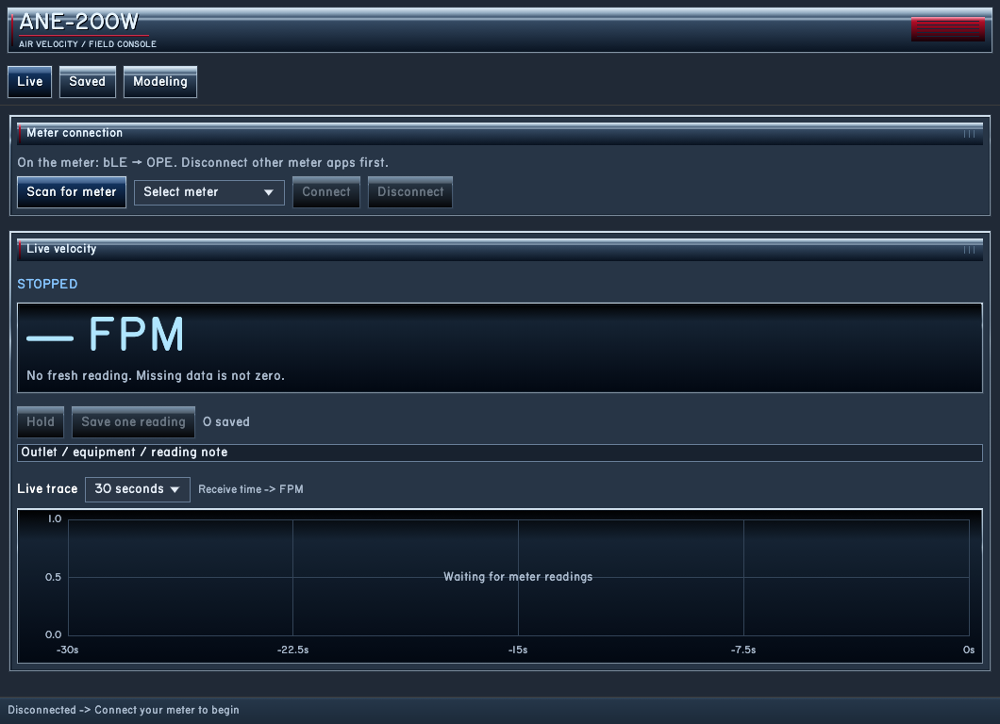
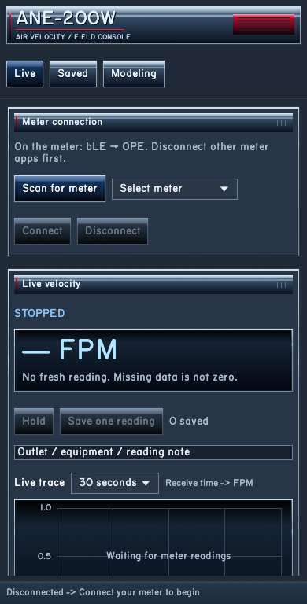

# ANE-200W Console — beginner technician instructions

This program reads the Elitech ANE-200W anemometer and saves measurements. Use the Windows program on the computer or install the supplied APK on an Android phone. Use one connected program at a time.

## Before measuring

I. Turn on the anemometer and check its battery indication.

II. Enable meter Bluetooth: hold **SET/HOLD** to enter settings, press it until **bLE** appears, select **OPE**, then hold **SET/HOLD** to save and return. The supplied manual describes this on pages 2–3.

III. Turn on phone/computer Bluetooth. Close any other program connected to this meter.

IV. Open **ANE-200W Console**. On Windows, use `Start Windows.cmd` in the suite folder. On Android, open the installed app.

V. Press **Scan for meter**. Allow Bluetooth/Nearby Devices permission on Android, then Scan again if prompted. Older Android versions also need location permission for Bluetooth scanning.

VI. Select the correct meter and press **Connect**, then **Start live readings**.

Scanning takes about ten seconds and does not itself start capture.

| Windows view | Phone-width preview |
| --- | --- |
|  |  |

The views above show the disconnected state. Connect and start readings before recording measurements.

## Read the meter

The large number is velocity in **FPM** (feet per minute). Smaller values show m/s, °F and relative humidity. These are individual readings, not a running average. Check them against the meter before using them for a field report.

Choose a graph window such as 5, 30 or 120 seconds to change the visible history. This does not change meter settings or the polling interval.

**FPM is velocity, not CFM.** CFM requires an appropriate area or independently established conversion factor. Nominal grille face area alone is not proof of effective measurement area.

## Hold and save one reading

I. Enter a note, for example `AHU-01 / Outlet-01 / final`.

II. Position the instrument and wait for the reading you intend to record.

III. Press **Hold** to freeze that displayed reading. The graph and incoming measurements continue.

IV. Press **Save one reading** once. Confirm the save message and increased count. Another press creates another saved reading.

V. Press **Resume live** before taking the next reading.

You can also save while live. A held reading keeps its original receive time, even if saved later. The time you pressed Save is recorded separately. Neither is asserted to come from an instrument clock.

## Export

Open **Saved**, then press **Export saved CSV**.

\- **Windows:** the confirmation shows the file under `local/exports/`. **Open data folder** opens storage. Copy the CSV to your project folder.

\- **Android:** the confirmation identifies the copy in **Downloads**. Older Android versions may request storage permission; grant it and repeat Export if instructed.

Exporting does not clear instrument memory or delete saved readings. Export before uninstalling the phone app.

For later investigation, stop readings, expand **Diagnostics & raw evidence**, and export the latest raw capture. Its JSONL contains packet bytes and receive times.

## Calculate airflow on Windows

I. Open **Modeling**. Use **Choose file…** or enter the path of an exported measurement CSV.

II. Press **Import CSV**.

III. Enter the appropriate area in square feet and multiplier.

IV. Press **Calculate**. The result uses the arithmetic sample mean: `CFM = FPM × area × multiplier`.

V. Press **Export calculated CFM** to save the calculation separately.

Use **Reference coefficient** with independent reference measurements. Enter `FPM, CFM` pairs, one per line. The effective area and residuals describe those references; they do not certify the meter or a factor for a different outlet product.

## Know the status

| Status | Meaning |
| --- | --- |
| **LIVE** | Recent valid data is arriving. |
| **HELD SNAPSHOT** | Frozen reading with its original time. Resume for current data. |
| **WAITING / STALE** | No fresh valid sample. Check the meter and connection. |
| **STOPPED / Disconnected** | Capture stopped; saved records remain available. |
| Numeric **0.0 FPM** | Valid zero-speed reading, different from missing data. |
| Dash **— FPM** | No fresh reading; do not record it as zero. |

Keep Android open while measuring. Switching apps, turning off the screen or interrupting the activity may disconnect it. Reconnect and restart afterward. Gaps are never filled with invented values.

If no meter appears, check `bLE → OPE`, power, permissions and other connected apps. Older Android versions may also need the phone's location service enabled. If readings remain stale, stop, disconnect and reconnect. Do not repeatedly save a held reading as though it were new.

## Finish

Press **Stop**, export the required readings, verify the file, then **Disconnect**. Turn off the instrument when finished. The suite changes no instrument settings or stored-meter records.
